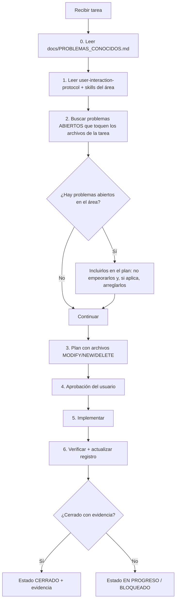

# Regla 0 — Problemas conocidos primero

Esta regla existe por una razón concreta: **el mismo error se ha repetido varias veces en este
proyecto** (bypass de auth por defecto, guardar en claro, resolver claves del proveedor equivocado,
desconectar una validación de seguridad, ocultar errores con `safe_error_message`, etc.).
Cada vez que se repite, cuesta horas y pone en riesgo datos reales.

> **Antes de tocar una sola línea de código, lee `docs/PROBLEMAS_CONOCIDOS.md` completo.**

---

## 1. Flujo obligatorio



### Paso 0 — Lectura (bloqueante)
- Leer `docs/PROBLEMAS_CONOCIDOS.md` **entero**, no solo el resumen.
- Identificar los problemas cuyo *archivo/área* coincide con la tarea.
- Si el registro no se ha leído, **no se permite editar ningún archivo**.

### Paso 2 — Cruce con la tarea
| Situación | Acción |
|---|---|
| La tarea toca un problema `ABIERTO` | Incluirlo en el alcance. No se puede "arreglar" la tarea dejando el problema peor. |
| La tarea toca un problema `CERRADO` | Leer su *regla anti-repetición* y no reintroducir el patrón. |
| Encuentras un problema **nuevo** | Registrarlo en `docs/PROBLEMAS_CONOCIDOS.md` **antes** de corregirlo (R5). |
| El problema existente es el mismo patrón en otro archivo | **No** crear un ID nuevo: ampliar el existente. |
| No hay problemas relacionados | Continuar, pero dejar constancia en el resumen final. |

### Paso 6 — Cierre con evidencia
No se puede marcar `CERRADO` sin al menos **una** de estas pruebas:
- Test que **falla antes** del cambio y **pasa después**.
- Comando reproducible (`pytest`, `tsc`, `npm audit`, `curl`) con salida pegada en la evidencia.
- Verificación manual documentada (captura o pasos exactos) cuando no sea automatizable.

Si no hay evidencia: el estado es `EN PROGRESO` o `BLOQUEADO`, nunca `CERRADO`.

---

## 2. Reglas anti-repetición (obligatorias)

1. **Defaults seguros.** Si falta configuración de seguridad, se **deniega**, no se habilita un bypass.
2. **Una sola puerta por preocupación.** Un único lugar resuelve claves de IA, un único lugar cifra y persiste.
3. **Sin texto plano.** Ni `.tmp`, ni `to_pickle`, ni `open(..., "w")` para datos de usuario.
4. **Sin listas negras de seguridad.** Usa allowlist; las listas negras dan falsa protección.
5. **Un control desconectado no existe.** Todo control de seguridad necesita un test que falle si se desenchufa.
6. **Nada inventado en la UI.** Sin números, estados ni modelos "de mentira".
7. **Errores útiles pero no filtrados.** Al cliente: código + `X-Request-Id`. En logs: detalle saneado.
8. **Sin `except: pass`.** Si se ignora un error, se registra con contexto.
9. **La UI lee el estado, no lo adivina.** Lo que se muestra (modelo, config, fuentes) viene del backend.
10. **Nada de efectos que se autoalimentan.** Un efecto no depende de un valor que él mismo escribe.

### 2.1 Excepción: el ajuste nuevo manda

Existe una excepción explícita a "no dañar lo que funciona":

> Si un ajuste nuevo (corrección o endurecimiento **justificado**) entra en conflicto con un
> comportamiento, una convención o un test viejo, **manda el ajuste nuevo** y lo viejo se
> **actualiza** para alinearse con él.

Condiciones para poder aplicar la excepción:

1. El ajuste nuevo está justificado (seguridad, corrección, requisito explícito) y anotado en el registro (`P-XX`).
2. Se actualizan **todos** los consumidores afectados en el mismo cambio (código, tests, docs, plantillas de entorno).
3. Queda registrado en el historial **qué contrato cambió y por qué**.
4. No se silencia ningún fallo sin explicar por qué el comportamiento viejo era incorrecto.

**Lo que esta excepción NO permite:**
- Revertir un arreglo de seguridad para "no romper" el comportamiento anterior.
- Borrar o debilitar un test que detecta una regresión real.
- Mantener dos comportamientos incompatibles a la vez.
- Usarla como excusa para cambios de alcance no pedidos.

---

## 3. Formato de una entrada nueva

```markdown
### P-XX · Título corto y descriptivo

| Campo | Valor |
|---|---|
| **Severidad** | CRÍTICO / ALTO / MEDIO / BAJO |
| **Estado** | ABIERTO |
| **Verificado** | ✅ Leyendo el código / 🧪 Con comando / 🔎 Reportado, a confirmar |
| **Archivos** | `ruta:línea` |

**Qué pasa.** Descripción técnica con el fragmento relevante.
**Impacto.** Qué puede pasar en producción, en una frase.
**Criterio de cierre.** Test o verificación concreta.
**Regla anti-repetición.** La lección generalizable.
```

Además: agregar la fila a la tabla de su severidad y actualizar el contador del resumen.

---

## 4. Checklist de autoverificación (antes de responder "listo")

- [ ] Leí `docs/PROBLEMAS_CONOCIDOS.md`.
- [ ] Cité los `P-XX` que tocan mi tarea y dije qué hice con cada uno.
- [ ] Si encontré algo nuevo, lo registré con ID y evidencia.
- [ ] Si cerré algo, la evidencia está anotada (test/comando/salida).
- [ ] No introduje ninguno de los 10 anti-patrones de la sección 2.
- [ ] Ejecuté la verificación del área (`pytest`, `tsc`, `npm run build`, `npm audit`).
- [ ] Actualicé el historial del registro con la fecha y el cambio.

---

## 5. Señales de alarma (detente y revisa)

- "Solo por ahora lo dejo en texto plano / con un bypass para que funcione."
- "Esta validación existe, así que ya estamos protegidos" → **¿está cableada? ¿tiene test?**
- "Uso la clave que haya" → **¿de qué proveedor?**
- "Al cliente le devuelvo `str(e)` para que se entienda."
- "El número lo pongo fijo para que se vea bonito."
- "El efecto se dispara dos veces, pero con un `if` lo tapo."

Cualquiera de estas frases = volver al registro y a la regla correspondiente.

---

## 6. Dónde vive cada cosa

| Recurso | Ruta |
|---|---|
| Registro de problemas | `docs/PROBLEMAS_CONOCIDOS.md` |
| Protocolo de interacción | `.codex/skills/user-interaction-protocol/SKILL.md` |
| Seguridad backend | `.codex/skills/vektra-security-review/SKILL.md` |
| Sandbox LLM | `.codex/skills/vektra-llm-sandbox-hardening/SKILL.md` |
| Ingesta de datos | `.codex/skills/vektra-data-ingestion/SKILL.md` |
| Estabilidad del agente | `.codex/skills/agent-stability-and-guidance-control/SKILL.md` |
